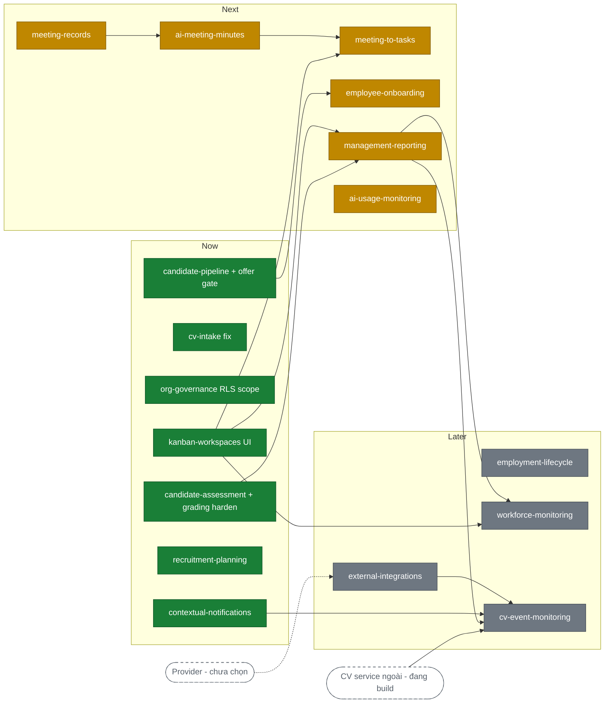

# Town Hown — Product Roadmap

## 1. Outcome mỗi giai đoạn

### Now — Nền pilot an toàn, đóng Must-gap

__Đạt được gì:__ Chuỗi recruitment chạy tin cậy đầu-cuối — bài test public không lộ đáp án, CV không kẹt ở PROCESSING, offer đi qua đúng gate, quyền truy cập siết đúng data-scope; mọi persona nhận thông báo đúng việc cần làm; luồng critical có regression gate tối thiểu.

__Đo bằng:__ `M-IN-01` (application không kẹt trạng thái quá SLA), `M-GR-01` (incident vượt data-scope = 0), `M-IN-03` (CV fields được HR giữ nguyên), tỷ lệ thông báo nghiệp vụ giao thành công.

* __Chấm điểm và phân tích năng lực__ (`assessment-grading`) + __Thực hiện bài đánh giá__ (`candidate-assessment`) — vá lộ answer key ở public test và đưa submit control về server.
* __Tiếp nhận và chuẩn hóa CV__ (`cv-intake`) — vá nhánh CV kẹt PROCESSING.
* __Điều phối pipeline ứng viên__ (`candidate-pipeline`) + __Tạo và theo dõi offer__ (`offer-management`) — wire multi-round offer gate, chặn first-result chốt pipeline, bổ sung offers table.
* __Quản lý tổ chức, quyền và audit__ (`org-governance`) — siết public-select policy rộng và admin-client ownership scope trên các bảng assessment/recruitment.
* __Gửi thông báo theo ngữ cảnh__ (`contextual-notifications`) — đóng Must-gap: notifications table, event dispatch in-app/email, preference tối thiểu.
* __Lập và phê duyệt nhu cầu tuyển dụng__ (`recruitment-planning`) — bổ sung request→approval và headcount.
* __Quản lý Kanban và bàn giao công việc__ (`kanban-workspaces`) — build UI cho `crm_tasks`/tasks API đã có sẵn; là mắt xích mở đường cho meeting-to-tasks, reporting, workforce-monitoring.
* Test baseline cho luồng critical (work item nền tảng, không thuộc Feature Map).

### Next — Từ quyết định đến thực thi

__Đạt được gì:__ Ứng viên accept offer trở thành nhân viên có checklist ngày đầu đủ owner/hạn; cuộc họp tạo ra biên bản được xác nhận rồi chuyển thành task trên kanban; quản lý/lãnh đạo thấy KPI cross-domain và cảnh báo sớm.

__Đo bằng:__ tỷ lệ checklist onboarding hoàn tất trước ngày bắt đầu; tỷ lệ action item được giao đúng owner; tỷ lệ cảnh báo dẫn tới action được xác nhận.

* __Thực hiện onboarding__ (`employee-onboarding`) — conversion + checklist giấy tờ/thiết bị/tài khoản.
* __Quản lý cuộc họp và transcript__ (`meeting-records`) — meeting entity + participants + recording/transcript, tái dùng pipeline interview-room.
* __Tạo và xác nhận biên bản bằng AI__ (`ai-meeting-minutes`) — AI trích quyết định/action → chủ trì xác nhận.
* __Chuyển biên bản thành công việc__ (`meeting-to-tasks`) — action item → task có owner + link nguồn.
* __Tạo báo cáo và cảnh báo quản trị__ (`management-reporting`) — KPI cross-domain trên recruitment + assessment + task.
* __Theo dõi mức sử dụng AI__ (`ai-usage-monitoring`) — làm tiếp phần còn thiếu (xem OQ-3).

### Later — Mở rộng vận hành

* __Quản lý vòng đời và tài liệu nhân sự__ (`employment-lifecycle`) — hợp đồng/thử việc/nghỉ việc + tài liệu có phê duyệt.
* __Theo dõi vận hành nhân viên minh bạch__ (`workforce-monitoring`) — dashboard progress/overdue/workload.
* __Kết nối lịch, webhook và công cụ ngoài__ (`external-integrations`) — trì hoãn chờ chọn provider (OQ-2).
* __Giám sát sự kiện vi phạm bằng Computer Vision__ (`cv-event-monitoring`) — phần HRMS tiếp nhận event; bị chặn bởi CV service ngoài đang build (OQ-1) và `external-integrations` chưa có.

## 2. Xếp hạng ưu tiên

| Tính năng | Slug | MoSCoW | Reach | Impact | Confidence | Evidence | Effort | Điểm | Phụ thuộc | Sẵn sàng dep | Rủi ro | Giai đoạn |
|---|---|---|---|---|---|---|---|---|---|---|---|---|
| Tiếp nhận và chuẩn hóa CV | `cv-intake` | Must | 4 | 4 | 1.0 | Dữ liệu trực tiếp | S | 16.0 | 5,17,18 | ✅ sẵn | Parse sai làm sai facts | Now |
| Thực hiện bài đánh giá + Chấm điểm | `candidate-assessment`, `assessment-grading` | Must | 4 | 5 | 1.0 | Dữ liệu trực tiếp | M | 10.0 | 21,22 | ✅ sẵn | Lộ answer key; submit control ở client | Now |
| Quản lý tổ chức, quyền và audit | `org-governance` | Must | 5 | 5 | 0.8 | Tín hiệu gián tiếp | M | 10.0 | 1 | ✅ sẵn | Public-select rộng, admin scope vượt RLS | Now |
| Gửi thông báo theo ngữ cảnh | `contextual-notifications` | Must | 5 | 4 | 0.8 | Giả định | M | 8.0 | 1,2 | ✅ sẵn | Gửi sai người/lộ dữ liệu | Now |
| Quản lý Kanban và bàn giao | `kanban-workspaces` | Should | 4 | 4 | 0.8 | Giả định | M | 6.4 | 2 | ✅ sẵn | Status cập nhật nhưng thiếu outcome | Now |
| Test baseline luồng critical | _(foundation, ngoài Feature Map)_ | — | 5 | 4 | 0.8 | Tín hiệu gián tiếp | L | 5.3 | — | — | Không có regression gate | Now |
| Pipeline + offer gate | `candidate-pipeline`, `offer-management` | Must/Should | 2 | 4 | 1.0 | Dữ liệu trực tiếp | M | 4.0 | 8,10 | ✅ sẵn | Gate không được gọi; first-result chốt | Now |
| Lập và phê duyệt nhu cầu tuyển dụng | `recruitment-planning` | Must | 2 | 4 | 0.8 | Giả định | M | 3.2 | 2 | ✅ sẵn | Mở tuyển khi authority chưa rõ | Now |
| Chuyển biên bản thành công việc | `meeting-to-tasks` | Should | 3 | 3 | 0.5 | Giả định | S | 4.5 | 14,16 | ⏳ 16 ở Now | Duplicate task/mất link nguồn | Next |
| Tạo và xác nhận biên bản bằng AI | `ai-meeting-minutes` | Should | 4 | 4 | 0.5 | Giả định | M | 4.0 | 13 | ⏳ 13 cùng Next | Gán sai người/bỏ quyết định | Next |
| Quản lý cuộc họp và transcript | `meeting-records` | Should | 4 | 3 | 0.5 | Giả định | M | 3.0 | 1 | ✅ sẵn | Recording vượt retention | Next |
| Thực hiện onboarding | `employee-onboarding` | Should | 3 | 4 | 0.5 | Giả định | M | 3.0 | 3,11 | ⏳ 11 ở Now | Task không owner/quá hạn | Next |
| Báo cáo và cảnh báo quản trị | `management-reporting` | Should | 2 | 4 | 0.5 | Giả định | M | 2.0 | 8,16,22,23 | ⏳ 16,22,23 ở Now | Aggregate lộ dữ liệu ngoài scope | Next |
| Theo dõi mức sử dụng AI | `ai-usage-monitoring` | Should | 1 | 2 | 0.8 | Giả định | S | 1.6 | 2,28 | ✅ sẵn | — | Next |
| Vòng đời và tài liệu nhân sự | `employment-lifecycle` | Could | 3 | 3 | 0.5 | Giả định | L | 1.5 | 3 | ✅ sẵn | Chuyển trạng thái thiếu phê duyệt | Later |
| Theo dõi vận hành nhân viên | `workforce-monitoring` | Could | 2 | 3 | 0.5 | Giả định | M | 1.5 | 2,16,25 | ⏳ 16 Now, 25 Next | Cảnh báo thành giám sát xâm phạm | Later |
| Kết nối lịch, webhook, công cụ ngoài | `external-integrations` | Should | TBD | TBD | TBD | — | TBD | TBD | 2 | ❌ chưa chọn provider | Duplicate/stale data | Later |
| Giám sát sự kiện vi phạm (CV) | `cv-event-monitoring` | Could | 2 | 3 | 0.5 | Giả định | M | 1.5 | 16,25,26,27 + CV service | ❌ CV service đang build | Cảnh báo AI bị dùng như kết luận | Later |

*Điểm = (Reach × Impact × Confidence) ÷ Effort — band ordinal để xếp hạng tương đối trong phiên này, không phải đo lường tuyệt đối. Thang Reach/Impact 1-5, Confidence 1.0/0.8/0.5, Effort S=1/M=2/L=3. Quy mô Reach hiệu chỉnh: 50-300 người nội bộ + vài trăm ứng viên/quý.*

Đã hoàn thiện trong code (đối chiếu reverse-SRS tại `docs/_reverse/`, không còn việc nên không xếp hạng): `account-access`, `employee-profiles`, `candidate-matching`, `interview-management`, `interview-evaluation`, `document-intake`, `document-review`, `question-bank`, `ai-question-generation`, `assessment-authoring`, `interview-recording`, `platform-configuration`, `document-library`, `assessment-templates`, `talent-framework`, `employee-evaluation`, `skill-gap-analysis`, `operational-email`, `release-announcements`, `vision-ocr`.

## 3. Now (đang / sắp làm)

* __Chấm điểm + Thực hiện bài đánh giá__ (`candidate-assessment`, `assessment-grading`) — public test không còn trả answer key, server enforce schedule/capacity/single-attempt trước insert · Tại sao bây giờ: GAP-AS-06 Critical, lộ dữ liệu trực tiếp cho ứng viên · Rủi ro: đã rõ trong reverse spec · Chi tiết hóa: ⬜ chưa (đây là vá lỗi, đi thẳng dev workflow)
* __Tiếp nhận và chuẩn hóa CV__ (`cv-intake`) — CV không kẹt PROCESSING sau 422 · Tại sao bây giờ: lỗi đang chặn đầu vào pipeline · Rủi ro: thấp, fix nhỏ ở `cv-analysis/route.ts` · Chi tiết hóa: ⬜
* __Pipeline + offer__ (`candidate-pipeline`, `offer-management`) — offer-gate được gọi, first result không tự chốt pipeline · Tại sao bây giờ: logic gate đã viết nhưng không được gọi (GAP-RC-01) · Rủi ro: đụng recruitment flow đang chạy — cần test baseline trước · Chi tiết hóa: ⬜
* __Quản lý tổ chức, quyền và audit__ (`org-governance`) — siết public-select + admin-client scope trên bảng assessment/recruitment · Tại sao bây giờ: 3 policy public rộng + service access có thể vượt RLS intent (GAP-AS-02, RC-04, RC-05) · Rủi ro: siết quá tay chặn luồng đang dùng — cần threat-model review kèm · Chi tiết hóa: ⬜
* Test baseline — regression tối thiểu cho auth/email/pipeline/assessment trước và sau các vá trên · Tại sao bây giờ: toàn repo không có automated test (GAP-PL-02) · Rủi ro: coverage mỏng ban đầu · Chi tiết hóa: n/a
* __Gửi thông báo theo ngữ cảnh__ (`contextual-notifications`) — notifications table + dispatch event→recipient→in-app/email + preference · Tại sao bây giờ: Must-gap cuối cùng của nền; các feature Next (task, onboarding, biên bản) đều cần nó · Rủi ro: gửi sai người — cần recipient context rõ · Chi tiết hóa: ⬜ — vào `/brainstorm` đầu tiên
* __Quản lý Kanban và bàn giao__ (`kanban-workspaces`) — UI cho tasks API có sẵn · Tại sao bây giờ: backend xong, chỉ thiếu màn hình; mở đường 15/25/29 · Rủi ro: thấp · Chi tiết hóa: ⬜
* __Lập và phê duyệt nhu cầu tuyển dụng__ (`recruitment-planning`) — request→approval + headcount trên JD · Tại sao bây giờ: Must-gap ở đầu chuỗi recruitment · Rủi ro: thấp · Chi tiết hóa: ⬜

## 4. Next (kế tiếp)

* __Thực hiện onboarding__ (`employee-onboarding`) — accept offer → hồ sơ nhân viên + checklist có owner/hạn · Phụ thuộc: `employee-profiles` ✅, `offer-management` (hoàn thiện ở Now) · Rủi ro: task không owner/quá hạn
* __Quản lý cuộc họp và transcript__ (`meeting-records`) — meeting entity + recording/transcript · Phụ thuộc: `account-access` ✅; tái dùng pipeline `interview-room` · Rủi ro: recording vượt retention
* __Tạo và xác nhận biên bản bằng AI__ (`ai-meeting-minutes`) — AI trích quyết định → chủ trì xác nhận → publish · Phụ thuộc: `meeting-records` (cùng Next, làm trước) · Rủi ro: gán sai người
* __Chuyển biên bản thành công việc__ (`meeting-to-tasks`) — action → task + link nguồn · Phụ thuộc: `ai-meeting-minutes`, `kanban-workspaces` (Now) · Rủi ro: duplicate task
* __Báo cáo và cảnh báo quản trị__ (`management-reporting`) — KPI cross-domain + overdue/risk + export · Phụ thuộc: `kanban-workspaces`, `candidate-assessment`, `assessment-grading` (Now) · Rủi ro: aggregate lộ dữ liệu ngoài scope
* __Theo dõi mức sử dụng AI__ (`ai-usage-monitoring`) — làm tiếp phần còn thiếu · Phụ thuộc: `org-governance`, `platform-configuration` ✅ · Rủi ro: scope chưa chốt (OQ-3)

## 5. Later (định hướng)

* __Vòng đời và tài liệu nhân sự__ (`employment-lifecycle`) — Lý do chưa làm ngay: Could + effort L; chờ onboarding chạy ổn đã
* __Theo dõi vận hành nhân viên minh bạch__ (`workforce-monitoring`) — Lý do: phụ thuộc `kanban-workspaces` + `management-reporting` chưa xong; cần privacy policy công bố trước
* __Kết nối lịch, webhook và công cụ ngoài__ (`external-integrations`) — Lý do: chưa chọn provider (OQ-2); owner phải quyết integration contract trước
* __Giám sát sự kiện vi phạm bằng CV__ (`cv-event-monitoring`) — Lý do: CV service ngoài repo đang build (OQ-1) + phụ thuộc `external-integrations`, `management-reporting`, `contextual-notifications`

## 6. Phụ thuộc

Xanh = Now, vàng = Next, xám = Later, nét đứt trắng = hệ thống/quyết định ngoài.

## 7. Câu hỏi mở

* [ ] OQ-1: CV service cho `cv-event-monitoring` đang build tới đâu — endpoint contract (event schema, auth, retry) và khi nào sẵn sàng bắn event về HRMS?
* [ ] OQ-2: `external-integrations` — chọn provider nào trước (calendar Google/Outlook? form? webhook nhận từ hệ thống nào)?
* [ ] OQ-3: `ai-usage-monitoring` "làm tiếp" gồm phạm vi gì — trang riêng, alert ngưỡng, hay budget/cost cap?
* [ ] OQ-4: `contextual-notifications` — preference tối thiểu gồm những gì (tắt theo loại event? theo kênh in-app/email?) và SLA delivery kỳ vọng?

## 8. Bước tiếp theo

* Các mục vá gap ở Now (answer key, CV kẹt, offer gate, RLS scope, test baseline) là defect/hardening — đưa thẳng vào dev workflow, không cần brainstorm.
* `/brainstorm contextual-notifications` — feature build đầu tiên của Now; brainstorm tiếp `kanban-workspaces` (UI) và `recruitment-planning` (approval flow).
* `/prd` — nếu thêm/sửa tính năng trong Feature Map (tự vào update mode) rồi chạy lại `/roadmap` để xếp lại.
