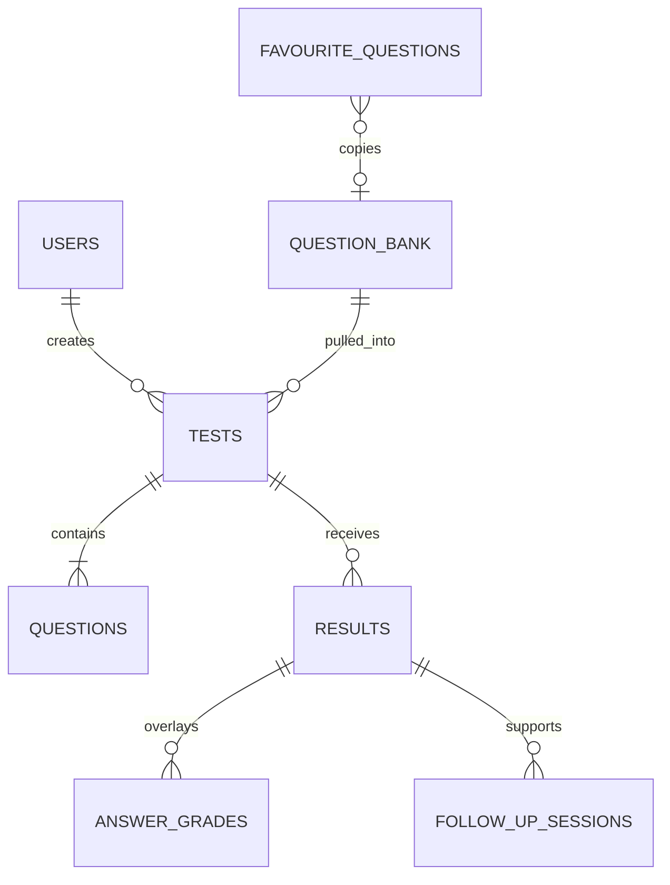

# ERD — Assessment và grading

Cardinality được suy ra từ foreign-key usage và query relations; xem
[sources](sources.md) trước khi dùng làm migration authority.

Bảng authority: `Backend/supabase/migrations` khớp live `itba-ai` (46 bảng
`public`) tại 2026-09-02, trừ `lock_public_assessment_access` chưa apply lên
live.
