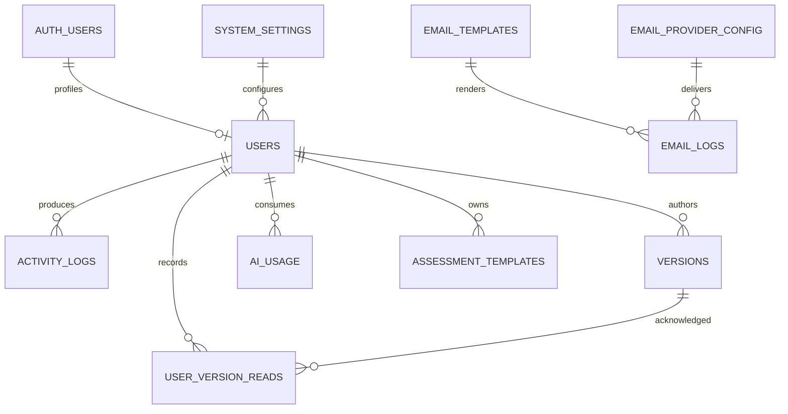

# ERD — Platform, communications và governance

`versions` có `CREATE TABLE` trong
`Backend/supabase/migrations/20260325000000_create_versions_table.sql` (trước
đây chỉ ALTER, bảng do dashboard tạo trên live).
