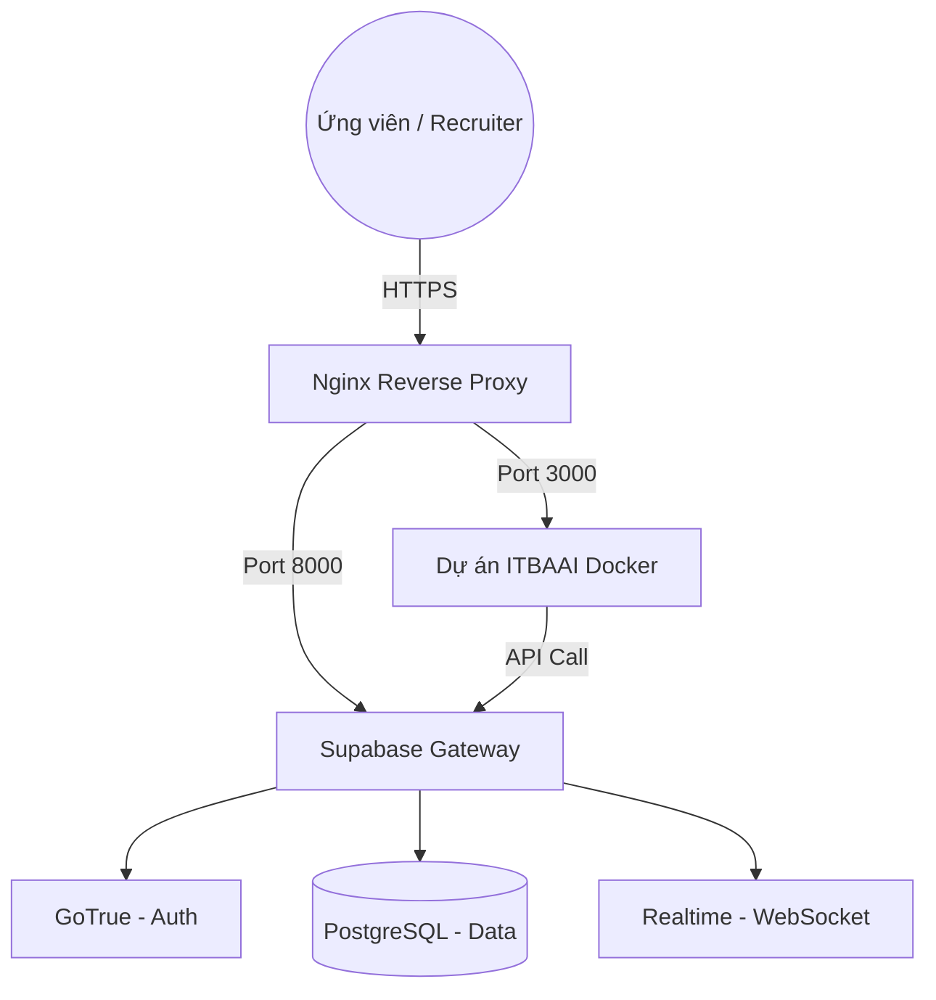

# Hướng dẫn Chuyên sâu: Tự Host Supabase trên VPS cho ITBAAI

> **Phương án tham khảo, chưa phải architecture hiện hành.** Lệnh/file của
> upstream Supabase có thể thay đổi; chỉ áp dụng sau khi pin phiên bản upstream,
> xác minh tài liệu chính thức, threat review, backup và upgrade plan.

Tài liệu này hướng dẫn cách triển khai hệ sinh thái Supabase (PostgreSQL, Auth, Realtime, Storage, v.v.) trực tiếp trên VPS của bạn bằng Docker và kết nối nó với dự án ITBAAI.

## 1. Yêu cầu Hệ thống (VPS)

Do Supabase chạy nhiều dịch vụ cùng lúc (GoTrue, PostgREST, Kong, v.v.), cấu hình VPS khuyên dùng là:
- **Hệ điều hành**: Ubuntu 22.04 LTS (hoặc mới hơn).
- **CPU**: Tối thiểu 2 Cores.
- **RAM**: Tối thiểu 4GB (Khuyên dùng 8GB để chạy ổn định kèm ứng dụng).
- **Disk**: SSD 20GB trở lên.
- **Docker & Docker Compose**: Đã được cài đặt.

---

## 2. Các bước Cài đặt Supabase

### Bước 1: Tải cấu hình Docker của Supabase
Đăng nhập vào VPS qua SSH và chạy lệnh:
```bash
cd /app
git clone --depth 1 https://github.com/supabase/supabase
cd supabase/docker
cp .env.example .env
```

### Bước 2: Cấu hình Biến Môi trường (.env)
Bắt buộc phải thay đổi các giá trị sau trong file `.env` để bảo mật:

1.  **POSTGRES_PASSWORD**: Mật khẩu cho cơ sở dữ liệu chính.
2.  **JWT_SECRET**: Một chuỗi ngẫu nhiên dài (Ví dụ: dùng `openssl rand -base64 32`).
3.  **ANON_KEY**: Mã khóa công khai (Dùng trang `https://jwt.io/` để tạo với JWT_SECRET).
4.  **SERVICE_ROLE_KEY**: Mã khóa quản trị (Cực kỳ quan trọng, dùng để bypass RLS).
5.  **DASHBOARD_USERNAME** & **DASHBOARD_PASSWORD**: Tài khoản đăng nhập vào giao diện Studio (Cổng 8001).

### Bước 3: Cấu hình SMTP (Để Đăng ký/Đăng nhập chạy được)
Tìm các dòng `SMTP_*` trong file `.env` và điền thông tin (Ví dụ dùng Gmail):
```env
# /supabase/docker/.env
SMTP_ADMIN_EMAIL=admin@yourdomain.com
SMTP_HOST=smtp.gmail.com
SMTP_PORT=587
SMTP_USER=your-email@gmail.com
SMTP_PASS=your-google-app-password
SMTP_SENDER_NAME=ITBAAI Auth
```

### Bước 4: Khởi động Supabase
```bash
docker compose pull
docker compose up -d
```
Sau lệnh này, các dịch vụ sẽ hoạt động tại:
- **API (Kong)**: `http://localhost:8000`
- **Studio (Dashboard)**: `http://localhost:8001`

---

## 3. Cấu hình Nginx & SSL (Bảo mật)

Bạn nên trỏ tên miền (ví dụ: `api.itbaai.com` và `db.itbaai.com`) về VPS và dùng Nginx để cài SSL.

### File cấu hình Nginx mẫu cho API (Kong):
```nginx
server {
    listen 80;
    server_name api.yourdomain.com;

    location / {
        proxy_pass http://localhost:8000;
        proxy_set_header Host $host;
    }
}
```

Dùng **Certbot** để cài HTTPS: `sudo certbot --nginx -d api.yourdomain.com`.

---

## 4. Di chuyển Dữ liệu (Migrations)

Dự án ITBAAI đã có sẵn các file migration trong thư mục `supabase/migrations/`. Bạn cần chạy chúng lên cơ sở dữ liệu mới.

1.  Truy cập Studio tại `https://db.yourdomain.com` (Cổng 8001).
2.  Vào Dashboard -> **SQL Editor**.
3.  Copy nội dung của tất cả file trong `supabase/migrations/` (Theo thứ tự thời gian) và chạy.
4.  **Lưu ý quan trọng**: Kiểm tra xem phần mở rộng `uuid-ossp` đã được bật chưa (thường tự động bật trong file `init_schema.sql`).

---

## 5. Kết nối Dự án ITBAAI

Cập nhật file `.env` của ứng dụng ITBAAI để trỏ về Supabase tự host:

```env
# /.env (Của dự án Next.js)
NEXT_PUBLIC_SUPABASE_URL=https://api.yourdomain.com
NEXT_PUBLIC_SUPABASE_ANON_KEY=mã-anon-khớp-với-supabase-env
SUPABASE_SERVICE_ROLE_KEY=mã-service-role-khớp-với-supabase-env
```

Nếu bạn triển khai ứng dụng ITBAAI bằng Docker trên cùng một máy, bạn có thể dùng mạng nội bộ Docker để kết nối: `http://supabase-kong:8000`.

---

## 6. Bảo trì & Sao lưu

1.  **Backup Database**: Chạy lệnh `docker exec` để dump dữ liệu:
    ```bash
    docker exec -t supabase-db pg_dumpall -c -U postgres > dump_`date +%d-%m-%Y`.sql
    ```
2.  **Cập nhật Supabase**: 
    - `cd /app/supabase`
    - `git pull`
    - `docker compose down`
    - `docker compose up -d`

## 7. Tổng kết Luồng Dữ liệu



> [!CAUTION]
> Tự host Supabase có nghĩa là bạn tự chịu trách nhiệm về bảo mật dữ liệu. Hãy đảm bảo mật khẩu Database và JWT Secret là cực kỳ khó đoán.
