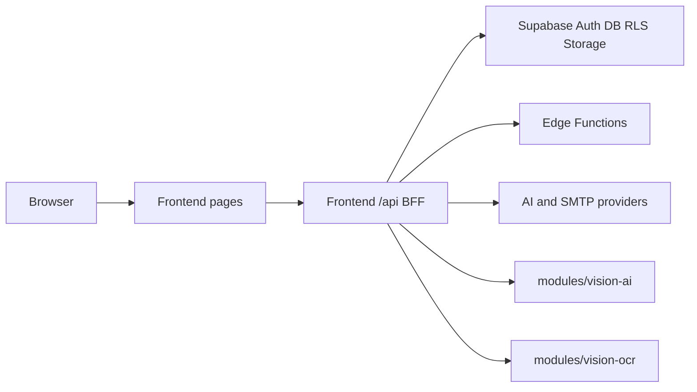

# Codebase summary

Navigation only. Open the owner below instead of treating this file as a tour.

## Entry points

| Start here | Why |
| --- | --- |
| [`Frontend/src/app`](../Frontend/src/app) | Pages, layouts, and same-origin BFF (`src/app/api`) |
| [`Frontend/src/middleware.ts`](../Frontend/src/middleware.ts) | Route-level session gate (not a substitute for API auth or RLS) |
| [`Frontend/package.json`](../Frontend/package.json) | Web app scripts and npm dependency lock partner |
| [`Backend/supabase/migrations`](../Backend/supabase/migrations) | Schema, RLS, storage evolution |
| [`Backend/supabase/functions`](../Backend/supabase/functions) | Deno Edge Functions |
| [`docker-compose.yml`](../docker-compose.yml) | Local/VPS process composition (`web`, Vision AI, Vision OCR) |
| [`Frontend/Dockerfile`](../Frontend/Dockerfile) | Production web image (Node 20, standalone Next.js) |

## Module boundaries

| Tree | Role |
| --- | --- |
| `Frontend/src/components` | Shared UI |
| `Frontend/src/lib` | Domain and provider helpers |
| `Frontend/src/types` | Shared contracts used by more than one consumer |
| `Backend/` | Supabase platform plus DB utilities |
| `modules/vision-ai/backend` | FastAPI ArcFace + YOLO execution service |
| `modules/vision-ocr` | Standalone document OCR slice |
| `modules/face-attendance` | Standalone attendance slice; product UI still belongs in `Frontend/` |

`modules/` UI is not the Town Hown design system. Integration copies verified
behavior into `Frontend/`, then restyles. See
[`downtown/design-guidelines.md`](downtown/design-guidelines.md).

## Schema and inventory owners

Do not copy table lists here.

- Git versus live/staging object contract: [`Backend/README.md`](../Backend/README.md)
- Reverse-engineered SRS drafts: [`_reverse/README.md`](_reverse/README.md)

## Boundaries in one picture

Rationale for keeping the BFF inside Next.js:
[`system-architecture.md`](system-architecture.md).
