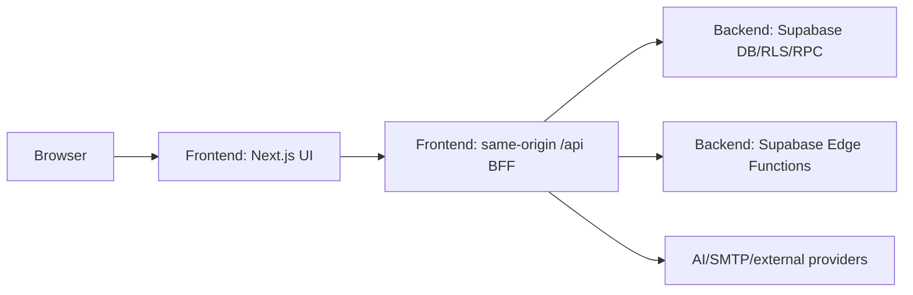

# Kiến trúc Town Hown

Tài liệu này sở hữu system boundaries, rationale và nơi tìm executable owners.
Nó không duy trì thủ công danh sách route, table, component hoặc dependency.

## Bối cảnh

Town Hown là HRMS B2B tích hợp AI. Source ứng dụng nằm trực tiếp tại
[`Frontend`](../../Frontend) và [`Backend`](../../Backend), dùng Next.js App
Router, Supabase/PostgreSQL/Auth/RLS, provider AI, email và Docker standalone.
Manifest và source quyết định phiên bản/hành vi thực tế.

## Ranh giới sau khi tách source



`Frontend` là một deployable Next.js duy nhất và **không phải browser-only**:
`Frontend/src/app/api` giữ server-side BFF để bảo toàn URL `/api/*`, cookie SSR,
upload/streaming và standalone deployment. `Backend` sở hữu Supabase platform:
schema, RLS, RPC, storage policies và Edge Functions. Di chuyển route handlers
sang service độc lập là một architecture migration khác, không thuộc lần tách
thư mục này.

```text
Candidate / Employee / HR / Interviewer / Manager / Admin
                         |
                     Web browser
                         |
             Next.js pages + route handlers
                         |
        Domain helpers / provider boundaries
          |              |               |
     Supabase         AI providers       SMTP/integrations
 Auth/DB/RLS/Storage  generation/OCR     email/calendar/webhook
```

## Executable owners

| Concern | Owner |
| --- | --- |
| Web UI và Next.js BFF | [`Frontend/src/app`](../../Frontend/src/app) |
| UI dùng chung | [`Frontend/src/components`](../../Frontend/src/components) |
| Hooks/realtime/update watcher | [`Frontend/src/hooks`](../../Frontend/src/hooks) |
| Domain/provider helpers | [`Frontend/src/lib`](../../Frontend/src/lib) |
| Shared contracts | [`Frontend/src/types`](../../Frontend/src/types) |
| Route-level session protection | [`Frontend/src/middleware.ts`](../../Frontend/src/middleware.ts) |
| Database/RLS/storage evolution | [`Backend/supabase/migrations`](../../Backend/supabase/migrations) |
| Schema contract vs live/staging | [`Backend/README.md`](../../Backend/README.md) |
| Edge processing | [`Backend/supabase/functions`](../../Backend/supabase/functions) |
| Frontend runtime/dependencies | [`Frontend/package.json`](../../Frontend/package.json) |
| Container artifact | [`Frontend/Dockerfile`](../../Frontend/Dockerfile), [`docker-compose.yml`](../../docker-compose.yml) |

## Layer boundaries

### Presentation

Pages/layouts trong `Frontend/src/app` compose domain components. Client component sở hữu
interaction/local state; dữ liệu có quyền và secret phải được xử lý lại tại
server/API/data boundary. UI ẩn button không phải authorization.

### HTTP/Application

Route handler parse input, xác định auth context, kiểm tra role/ownership/scope,
gọi helper domain và map response/error. Handler điều phối; logic dùng lại thuộc
module trong `Frontend/src/lib` hoặc owner domain gần nhất.

### Domain

Domain boundaries phản ánh product themes, không phản ánh tùy tiện cấu trúc màn:

- Recruitment: application, state transition, interview, offer/onboarding.
- Assessment: tests, questions, submissions, grading, analysis.
- Talent/CRM: persons, positions, skills, groups và derived scoring.
- Document AI: source file, extracted text, topics, jobs và generated artifacts.
- Meetings/Tasks: record, minutes, action item và work item provenance.
- Communication: notification, email template/provider và delivery evidence.

Rule quan trọng phải có owner tập trung. Ví dụ recruitment transition thuộc
[`state-machine.ts`](../../Frontend/src/lib/recruitment/state-machine.ts),
không được định nghĩa khác nhau giữa UI và API.

### Data

Supabase clients được tách theo browser/server/admin context tại
[`Frontend/src/lib/supabase`](../../Frontend/src/lib/supabase).

- Browser dùng anon configuration và session của user.
- Server dùng cookie/session để hành động dưới identity user.
- Service role chỉ ở server cho action cần bypass RLS đã được authorize.
- Migrations là authority schema/RLS; docs không liệt kê table thủ công.

## Domain data flow

### Recruitment

```text
Recruitment request/position
  -> CV source + verified extracted facts
  -> application + explainable matching
  -> controlled pipeline transitions
  -> interview/evaluation
  -> offer
  -> onboarding + employee profile
```

Derived score không thay source facts. AI result, HR override và transition
history cần phân biệt để truy nguyên.

### Assessment

```text
Question source/bank
  -> assessment configuration
  -> public/assigned access
  -> answers/submission
  -> objective/manual grading
  -> reviewer-confirmed analysis
```

Public token chỉ cấp quyền tối thiểu cho bài được chia sẻ; nó không mở dữ liệu
recruiter hoặc đáp án.

### Document AI

```text
Raw document
  -> validated storage/source record
  -> extraction/OCR
  -> topics/structured candidates
  -> human review
  -> publish into owning domain
```

Mỗi stage giữ provenance và trạng thái riêng. Retry không được tạo duplicate
business artifact; confidence không được biến thành fact trước review.

### Meeting to work

```text
Meeting/recording
  -> transcript
  -> AI-proposed minutes/actions
  -> chairperson confirmation
  -> task with source link
  -> progress/handoff/approval
```

AI không tự giao việc khi assignee/deadline chưa được xác nhận.

## Trust boundaries

- Request body, query, public token và uploaded file là untrusted.
- Provider output và AI-generated structured data là untrusted cho đến khi parse.
- Browser không nhận service-role, SMTP password hoặc server AI key.
- RLS là data defense; route authorization và RLS không thay thế nhau.
- Recording, CV, transcript, assessment và email là dữ liệu nhạy cảm.
- Operational logs và audit records là hai product objects khác nhau.

Chi tiết: [Security](security.md).

## External providers

Provider là implementation dependency, không phải domain owner:

- AI provider sinh/phân tích nội dung nhưng domain quyết định schema, review và
  trạng thái.
- SMTP/email provider gửi message nhưng workflow quyết định recipient/template
  và business outcome.
- Calendar/webhook/provider ngoài phải có reconciliation, idempotency và error
  ownership trước rollout.

## Runtime và deployment status

- Next.js được cấu hình standalone trong
  [`Frontend/next.config.ts`](../../Frontend/next.config.ts).
- Dockerfile/compose mô tả artifact có thể build và chạy.
- Pipeline GitLab đã được gỡ; không còn CI/CD deploy trong repo.
- Production deployment authority chưa được xác nhận. Xem
  [Operations](operations.md).

## Observability và audit

Operational event cần đủ request/action/outcome để chẩn đoán nhưng không chứa
secret hoặc PII vượt nhu cầu. Business action quan trọng cần audit record với
actor, target, state before/after, reason và timestamp khi contract yêu cầu.

AI usage, email delivery, recruitment activity và login/access log phục vụ các
mục đích khác nhau; không gộp chúng thành một bảng/log chung chỉ vì đều là event.

## Quy tắc mở rộng

1. Feature mới map về đúng product capability và owner hiện có.
2. Chỉ tạo module mới khi concern có lifecycle/contract riêng.
3. Unknown data được parse tại boundary trước khi đi sâu vào hệ thống.
4. Public/schema/security contract change cần validation và docs owner update.
5. Quyết định kiến trúc bền vững có trade-off được ghi một lần; không chép vào
   nhiều runbook.
6. Không xem folder/route tồn tại là bằng chứng feature production-ready.
