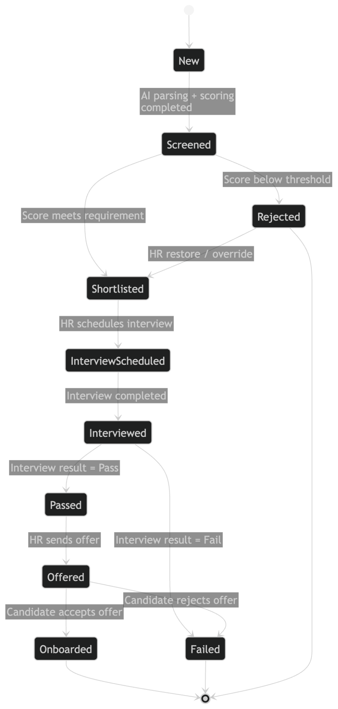

# Init req - DONE

# **Mô tả dự án website tạo bài test phỏng vấn IT/BA có AI hỗ trợ**

## **1. Mục tiêu hệ thống**

Xây dựng một website đơn giản phục vụ quy trình sàng lọc và hỗ trợ phỏng
vấn ứng viên IT/BA.

Hệ thống cho phép:

- Người phụ trách tuyển dụng chọn vị trí/phân loại level ứng viên như
  Fresher, Middle, Senior

- Hệ thống tự tạo bộ 10 câu hỏi trắc nghiệm phù hợp

- Gửi link bài test cho ứng viên

- Ứng viên làm bài trong thời gian giới hạn 15 phút

- Sau khi submit, hệ thống chấm điểm và hiển thị kết quả ngay

- AI phân tích kết quả làm bài và gợi ý thêm các câu hỏi phỏng vấn
  chuyên sâu để interviewer sử dụng trong vòng phỏng vấn tiếp theo

## **2. Đối tượng sử dụng**

Có 2 nhóm người dùng chính:

### **2.1. Recruiter / Interviewer / Admin**

Người tạo bài test và xem kết quả ứng viên.

### **2.2. Candidate**

Người nhận link, làm bài test và xem kết quả sau khi nộp bài.

## **3. Luồng nghiệp vụ chính**

### **Bước 1: Tạo bài test**

Recruiter vào hệ thống và nhập các thông tin:

- Vị trí tuyển dụng (ví dụ: Backend Developer, Frontend Developer, QA,
  DevOps...)

- Level ứng viên (Fresher / Middle / Senior)

- Có thể thêm mô tả ngắn về yêu cầu tuyển dụng hoặc skill cần đánh giá

Sau đó hệ thống sẽ tự generate:

- 10 câu hỏi trắc nghiệm

- Nội dung phù hợp với vị trí và level đã chọn

- Mỗi câu có các phương án trả lời rõ ràng

### **Bước 2: Tạo link làm bài**

Sau khi bộ câu hỏi được tạo xong:

- Hệ thống sinh ra 1 link riêng cho ứng viên

- Recruiter gửi link này cho ứng viên qua email / chat / tin nhắn

### **Bước 3: Ứng viên làm bài**

Khi mở link:

- Ứng viên thấy thông tin bài test

- Có đồng hồ đếm ngược 15 phút

- Ứng viên trả lời 10 câu hỏi

- Có nút Submit để nộp bài

- Nếu hết 15 phút thì hệ thống tự động submit

### **Bước 4: Hiển thị kết quả**

Ngay sau khi submit:

- Ứng viên có thể thấy kết quả cơ bản

- Recruiter có thể xem chi tiết:

  - Tổng điểm

  - Số câu đúng / sai

  - Đáp án ứng viên đã chọn

  - Đáp án đúng

### **Bước 5: AI phân tích và gợi ý phỏng vấn**

Dựa trên kết quả bài test, AI sẽ:

- Phân tích điểm mạnh / điểm yếu của ứng viên

- Đưa ra một số insight ban đầu

- Gợi ý bộ câu hỏi follow-up để interviewer hỏi sâu hơn trong buổi phỏng
  vấn

Ví dụ:

- Ứng viên mạnh về JavaScript cơ bản nhưng yếu về async handling

- Ứng viên hiểu React cơ bản nhưng thiếu kiến thức về performance
  optimization

- Hệ thống đề xuất 5–10 câu hỏi phỏng vấn tiếp theo tương ứng

## **4. Chức năng chính**

## **4.1. Phần dành cho Admin / Recruiter**

- Đăng nhập hệ thống

- Tạo bài test mới

- Chọn vị trí và level

- Generate bộ câu hỏi

- Xem / chỉnh sửa câu hỏi trước khi gửi nếu cần

- Tạo link gửi ứng viên

- Xem danh sách các bài test đã tạo

- Xem danh sách ứng viên đã làm bài

- Xem kết quả chi tiết từng ứng viên

- Xem phần AI insight và interview follow-up questions

## **4.2. Phần dành cho Candidate**

- Truy cập bằng link

- Xem hướng dẫn làm bài

- Làm 10 câu trắc nghiệm trong 15 phút

- Submit bài

- Xem kết quả sau khi hoàn thành

## **4.3. Chức năng AI**

- Sinh câu hỏi trắc nghiệm theo:

  - Job role

  - Candidate level

  - Skill focus

- Chấm và phân tích kết quả

- Tạo insight về ứng viên

- Đề xuất bộ câu hỏi phỏng vấn tiếp theo

## **5. Dữ liệu đầu vào và đầu ra**

### **Input**

Từ recruiter:

- Job position

- Candidate level

- Optional: job description, required skills

Từ candidate:

- Câu trả lời cho 10 câu hỏi trắc nghiệm

### **Output**

Cho recruiter:

- Bộ câu hỏi được generate

- Link test cho ứng viên

- Kết quả làm bài

- AI insight

- Gợi ý câu hỏi phỏng vấn tiếp theo

Cho candidate:

- Điểm số cơ bản sau khi nộp bài

## **6. Màn hình dự kiến**

### **6.1. Admin Dashboard**

- Danh sách bài test

- Nút tạo bài test mới

### **6.2. Create Test Page**

- Chọn vị trí

- Chọn level

- Nhập kỹ năng hoặc mô tả

- Nút generate questions

### **6.3. Question Review Page**

- Hiển thị 10 câu hỏi đã tạo

- Có thể chỉnh sửa / xác nhận

- Nút tạo link test

### **6.4. Candidate Test Page**

- Thông tin bài test

- Đồng hồ đếm ngược

- Danh sách câu hỏi

- Nút submit

### **6.5. Result Page**

- Điểm số

- Đúng / sai từng câu

- Nhận xét tổng quan

### **6.6. AI Analysis Page**

- Insight ứng viên

- Các chủ đề cần hỏi sâu

- Danh sách câu hỏi gợi ý cho interviewer

## **7. Quy tắc nghiệp vụ chính**

- Mỗi bài test gồm đúng 10 câu hỏi

- Thời gian làm bài là 15 phút

- Hết thời gian thì tự submit

- Mỗi link test chỉ gắn với 1 ứng viên hoặc 1 lượt làm bài

- Kết quả hiển thị ngay sau khi nộp

- AI chỉ gợi ý câu hỏi phỏng vấn sau khi đã có kết quả bài test

- Câu hỏi được generate phải bám theo role và level đã chọn

## **8. Yêu cầu phi chức năng**

- Giao diện đơn giản, dễ dùng

- Tương thích tốt trên desktop và mobile

- Tốc độ load nhanh

- Dữ liệu bài test và kết quả cần được lưu lại

- Có cơ chế tránh refresh làm mất dữ liệu trong lúc làm bài

- Cần đảm bảo link test không bị dùng sai mục đích hoặc truy cập trái
  phép

## **9. Gợi ý scope MVP**

Phiên bản đầu tiên chỉ cần làm gọn như sau:

- Admin login

- Tạo bài test theo role + level

- AI generate 10 câu hỏi

- Sinh link cho ứng viên

- Ứng viên làm bài trong 15 phút

- Submit và chấm điểm ngay

- Hiển thị kết quả cơ bản

- AI đưa ra insight và câu hỏi phỏng vấn follow-up

Chưa cần ở giai đoạn đầu:

- Phân quyền phức tạp

- Nhiều loại câu hỏi ngoài trắc nghiệm

- Anti-cheat nâng cao

- Báo cáo thống kê quá sâu

- Tích hợp email automation phức tạp

## **10. Mô tả ngắn gọn để gửi engineer**

We need a simple web-based interview testing platform for IT
candidates.  
The recruiter selects a job role and candidate level (Fresher / Middle /
Senior), then the system generates 10 multiple-choice questions
automatically. A test link is created and sent to the candidate. The
candidate answers within 15 minutes and submits the test. Right after
submission, the system shows the result immediately. Based on the
candidate’s answers, AI analyzes strengths/weaknesses and suggests
follow-up interview questions and candidate insights for the
interviewer.

Mar 16th - Phase 1

.**Bổ sung requirement cho website tạo bài test phỏng vấn IT/BA có AI hỗ
trợ**

## **1. Mục tiêu bổ sung**

Mở rộng hệ thống hiện tại để hỗ trợ sâu hơn cho interviewer trong quá
trình chuẩn bị câu hỏi, lưu trữ bộ câu hỏi dùng lại, đánh giá ứng viên
sau phỏng vấn, và xuất báo cáo nhanh.

Các mục tiêu bổ sung gồm:

- Cho phép interviewer **re-generate** lại bộ câu hỏi hoặc từng câu hỏi
  riêng lẻ

- Cho phép lưu bộ câu hỏi đã tạo vào kho **Favourite Questions  
  **

- Cho phép interviewer tạo nhanh **bộ câu hỏi follow-up mới** dựa trên
  kết quả AI phân tích của một ứng viên

- Cho phép interviewer ghi chú trực tiếp trên hồ sơ kết quả ứng viên

- Cho phép ghi âm toàn bộ buổi phỏng vấn và dùng AI để tạo summary +
  đánh giá mức độ phù hợp

- Cho phép chỉnh sửa lại AI summary sau khi AI generate

- Cho phép xuất nhanh file báo cáo PDF để phục vụ việc report nội bộ

- Cho phép interviewer đánh dấu trạng thái ứng viên là **Pass / Fail  
  **

## **2. Luồng nghiệp vụ bổ sung**

### **2.1. Re-generate câu hỏi ở màn hình tạo câu hỏi**

Tại màn hình tạo câu hỏi phỏng vấn, sau khi hệ thống đã generate bộ câu
hỏi:

- Recruiter / Interview có thể chọn:

  - Re-generate toàn bộ bài test

  - Re-generate từng câu hỏi riêng lẻ

Khi nhấn nút **Re-generate**:

- Hệ thống mở một modal để hỏi nhu cầu thay đổi

- Trong modal có 2 cách thao tác:

  1.  Người dùng nhập thêm prompt để AI generate lại theo yêu cầu cụ thể

  2.  Người dùng không nhập prompt và nhấn generate nhanh, hệ thống sẽ
      dùng lại context cũ của lần tạo câu hỏi trước

Cách thức này áp dụng cho cả:

- Re-generate toàn bộ bài test

- Re-generate từng câu hỏi

### **2.2. Lưu bộ câu hỏi vào Favourite**

Sau khi bộ câu hỏi đã được tạo xong và người dùng hài lòng với kết quả:

- Người dùng có thể lưu bộ câu hỏi này vào kho Favourite

- Khi lưu, hệ thống gắn metadata để phân loại theo:

  - Level

  - Phòng ban / Department

Mục đích:

- Tái sử dụng các bộ câu hỏi tốt trong các lần tuyển dụng sau

- Giảm thời gian generate lại từ đầu

### **2.3. Tạo follow-up questions mới từ kết quả ứng viên**

Tại màn hình chi tiết kết quả của một ứng viên:

- Sau khi AI đã phân tích bài test xong, interviewer có thể nhấn nút để
  tạo nhanh bộ câu hỏi tiếp theo cho một session phỏng vấn mới

- Vẫn có tính năng edit lại follow-up questions khi cần (như tính năng
  2.2)

- Bộ câu hỏi này phải bám vào:

  - Kết quả bài test hiện tại

  - AI insight về điểm mạnh / điểm yếu

  - Các dấu hiệu ứng viên có thể đang che giấu hoặc chưa thể hiện rõ
    năng lực

Mục tiêu:

- Hỗ trợ interviewer khai thác sâu hơn tiềm năng thật

- Phát hiện điểm yếu hoặc khoảng trống kiến thức chưa lộ ra trong bài
  test đầu tiên

### **2.4. Ghi chú ứng viên**

Tại màn hình chi tiết kết quả của một ứng viên:

- Có thêm một field **Note** dạng optional

- Interviewer có thể nhập ghi chú thủ công về ứng viên

- Có thể nhấn Save để lưu lại

- Sau khi đã lưu vẫn có thể edit lại note

Ví dụ note:

- Thái độ tốt, giao tiếp ổn

- Có dấu hiệu học thuộc câu trả lời

- Cần kiểm tra sâu thêm về system design

### **2.5. Ghi âm buổi phỏng vấn + AI summary**

Tại màn hình chi tiết kết quả của một ứng viên:

- Có thêm tính năng ghi âm toàn bộ buổi phỏng vấn

- Sau khi kết thúc ghi âm, hệ thống xử lý audio và dùng AI để:

  - Tóm tắt nội dung cuộc phỏng vấn

  - Rút ra các điểm nổi bật

  - Đánh giá mức độ phù hợp tổng thể của ứng viên với JD ban đầu của job
    này

Sau khi AI generate summary:

- Interviewer có thể edit lại summary

- Mục đích là để sửa nhanh các phần AI hiểu sai hoặc bổ sung thêm thông
  tin quan trọng

### **2.6. Xuất báo cáo PDF**

Tại màn hình chi tiết kết quả của một ứng viên:

- Có nút xuất nhanh file báo cáo PDF

- Nội dung báo cáo được tổng hợp từ:

  - Kết quả bài test

  - AI summary của buổi phỏng vấn

  - Đánh giá mức độ phù hợp với job

  - Note của interviewer nếu có

Mục đích:

- Phục vụ việc report nhanh cho cấp trên

- Tạo tài liệu đánh giá ứng viên có thể chia sẻ nội bộ

### **2.7. Gắn trạng thái Pass / Fail cho ứng viên**

Tại màn hình detail kết quả ứng viên:

- Interviewer có thể chọn trạng thái:

  - Pass

  - Fail

- Trạng thái này được lưu vào hồ sơ ứng viên của bài test tương ứng

- Dùng để theo dõi kết quả sàng lọc và hỗ trợ quản lý pipeline tuyển
  dụng

## **3. Chức năng bổ sung**

### **3.1. Phần dành cho Admin / Recruiter / Interviewer**

Bổ sung các chức năng sau:

- Re-generate toàn bộ bộ câu hỏi

- Re-generate từng câu hỏi riêng lẻ

- Nhập prompt bổ sung khi re-generate

- Re-generate nhanh bằng context cũ

- Lưu bộ câu hỏi vào Favourite

- Phân loại Favourite theo level và department

- Tạo bộ câu hỏi follow-up mới từ kết quả AI phân tích của ứng viên

- Ghi chú ứng viên

- Chỉnh sửa ghi chú ứng viên

- Ghi âm buổi phỏng vấn

- Xử lý audio để AI tạo summary

- Chỉnh sửa AI summary

- Xuất báo cáo PDF

- Đánh dấu ứng viên Pass / Fail

### **3.2. Chức năng AI bổ sung**

Ngoài các chức năng AI hiện có, hệ thống cần hỗ trợ thêm:

- AI re-generate bộ câu hỏi dựa trên prompt mới hoặc context cũ

- AI re-generate từng câu hỏi riêng lẻ mà vẫn giữ đúng role / level /
  mục tiêu đánh giá

- AI tạo bộ câu hỏi follow-up mới dựa trên kết quả cụ thể của từng ứng
  viên

- AI transcript / summarize nội dung phỏng vấn từ file ghi âm

- AI đánh giá mức độ phù hợp tổng thể của ứng viên so với JD ban đầu

## **4. Dữ liệu đầu vào và đầu ra bổ sung**

### **Input**

Từ recruiter / interviewer:

- Prompt bổ sung khi re-generate

- Lựa chọn re-generate toàn bộ hoặc từng câu hỏi

- Thông tin phân loại Favourite:

  - Level

  - Department

- Note về ứng viên

- File audio hoặc dữ liệu ghi âm cuộc phỏng vấn

- Hành động chọn Pass / Fail

Từ hệ thống / context cũ:

- Job role

- Candidate level

- Job description / required skills đã nhập trước đó

- Bộ câu hỏi đã generate trước

- Kết quả bài test của ứng viên

- AI insight hiện có

- JD ban đầu của job

### **Output**

Cho recruiter / interviewer:

- Bộ câu hỏi mới sau khi re-generate

- Câu hỏi đơn lẻ mới sau khi re-generate

- Favourite question set đã lưu

- Bộ câu hỏi follow-up mới cho session tiếp theo

- Note đã lưu

- AI summary từ audio phỏng vấn

- Đánh giá mức độ phù hợp tổng thể

- File báo cáo PDF

- Trạng thái ứng viên Pass / Fail

## **5. Màn hình bổ sung / cập nhật**

### **5.1. Question Review Page**

Bổ sung:

- Nút **Re-generate Full Test  
  **

- Nút **Re-generate Question** tại từng câu hỏi

- Modal nhập prompt khi re-generate

- Nút generate nhanh không cần nhập prompt

- Nút **Save to Favourite  
  **

- Field chọn hoặc hiển thị metadata:

  - Level

  - Department

### **5.2. Candidate Result Detail Page**

Bổ sung:

- Nút **Generate Follow-up Questions  
  **

- Khu vực **Note** cho interviewer

- Nút Save / Edit note

- Khu vực **Interview Recording  
  **

  - Start recording

  - Stop recording

  - Trạng thái processing

- Khu vực **AI Interview Summary  
  **

  - Nội dung summary

  - Nút edit summary

- Khu vực **Candidate Overall Fit Evaluation  
  **

- Nút **Export PDF Report  
  **

- Trường trạng thái **Pass / Fail  
  **

### **5.3. Favourite Question Library Page**

Có thể bổ sung thêm một màn hình hoặc tab riêng:

- Danh sách các bộ câu hỏi yêu thích đã lưu

- Có phân loại theo:

  - Level

  - Department

- Có thể xem lại để tái sử dụng ở lần tạo test sau

## **6. Quy tắc nghiệp vụ bổ sung**

### **6.1. Re-generate**

- Người dùng có thể re-generate toàn bộ bài test hoặc từng câu hỏi riêng
  lẻ

- Nếu người dùng nhập prompt mới, AI phải ưu tiên prompt mới đó

- Nếu người dùng không nhập prompt, AI phải dùng lại context cũ của lần
  generate trước

- Khi re-generate từng câu hỏi, hệ thống chỉ thay thế đúng câu được
  chọn, không làm thay đổi các câu khác

- Nội dung re-generate vẫn phải bám theo role, level và mục tiêu đánh
  giá ban đầu

### **6.2. Favourite**

- Chỉ các bộ câu hỏi đã generate xong mới được lưu vào Favourite

- Một bộ Favourite phải được gắn ít nhất:

  - Level

  - Department

- Favourite được lưu để dùng lại ở các lần tạo test sau

### **6.3. Follow-up Questions**

- Chỉ được tạo follow-up questions sau khi đã có kết quả bài test và AI
  analysis của ứng viên

- Bộ câu hỏi follow-up mới phải dựa trên dữ liệu thực tế của đúng ứng
  viên đó

- Mục tiêu của bộ follow-up là khai thác sâu điểm mạnh, điểm yếu, lỗ
  hổng kiến thức, và khả năng ứng viên đang che giấu

### **6.4. Note**

- Note là optional

- Note chỉ dành cho recruiter / interviewer nội bộ

- Note có thể tạo mới, chỉnh sửa và lưu lại nhiều lần

### **6.5. Recording + AI Summary**

- Ghi âm được gắn với một ứng viên cụ thể

- Sau khi ghi âm xong, hệ thống mới bắt đầu xử lý AI summary

- AI summary có thể được interviewer chỉnh sửa lại trước khi dùng cho
  report

- Đánh giá overall fit phải bám theo JD ban đầu của job đang tuyển

### **6.6. Export PDF**

- File PDF được tạo từ dữ liệu mới nhất tại thời điểm export

- Nội dung báo cáo nên lấy từ:

  - Thông tin ứng viên

  - Kết quả bài test

  - AI analysis

  - AI interview summary

  - Note

  - Pass / Fail status

### **6.7. Pass / Fail**

- Mỗi ứng viên trong mỗi bài test cần có 1 trạng thái kết quả cuối cùng

- Trạng thái mặc định có thể để trống trước khi interviewer quyết định

- Khi đã chọn Pass / Fail, hệ thống lưu lại để phục vụ quản lý tuyển
  dụng

## **7. Yêu cầu phi chức năng bổ sung**

- Re-generate phải có thời gian phản hồi hợp lý

- Audio recording cần được lưu an toàn và gắn đúng với ứng viên

- AI summary không được ghi đè mất bản interviewer đã chỉnh sửa nếu
  người dùng đã bấm lưu

- PDF export cần tạo nhanh, dễ tải xuống và hiển thị đúng định dạng

- Favourite library cần dễ tìm kiếm và tái sử dụng

- Dữ liệu note, summary edit, Pass / Fail cần được lưu bền vững

Phase 2

### **2.2. Lưu bộ câu hỏi vào Favourite**

Sau khi bộ câu hỏi đã được tạo xong và người dùng hài lòng với kết quả:

- Người dùng có thể lưu bộ câu hỏi này vào kho Favourite

- Khi lưu, hệ thống gắn metadata để phân loại theo:

  - Level

  - Phòng ban / Department

Mục đích:

- Tái sử dụng các bộ câu hỏi tốt trong các lần tuyển dụng sau

- Giảm thời gian generate lại từ đầu

### **2.5. Ghi âm buổi phỏng vấn + AI summary**

Tại màn hình chi tiết kết quả của một ứng viên:

- Có thêm tính năng ghi âm toàn bộ buổi phỏng vấn

- Sau khi kết thúc ghi âm, hệ thống xử lý audio và dùng AI để:

  - Tóm tắt nội dung cuộc phỏng vấn

  - Rút ra các điểm nổi bật

  - Đánh giá mức độ phù hợp tổng thể của ứng viên với JD ban đầu của job
    này

Sau khi AI generate summary:

- Interviewer có thể edit lại summary

- Mục đích là để sửa nhanh các phần AI hiểu sai hoặc bổ sung thêm thông
  tin quan trọng

### **2.6. Xuất báo cáo PDF**

Tại màn hình chi tiết kết quả của một ứng viên:

- Có nút xuất nhanh file báo cáo PDF

- Nội dung báo cáo được tổng hợp từ:

  - Kết quả bài test

  - AI summary của buổi phỏng vấn

  - Đánh giá mức độ phù hợp với job

  - Note của interviewer nếu có

Mục đích:

- Phục vụ việc report nhanh cho cấp trên

- Tạo tài liệu đánh giá ứng viên có thể chia sẻ nội bộ

Phase 3 - Lọc CV

# **TÀI LIỆU MÔ TẢ YÊU CẦU**

## **Hệ thống: AI CV Screening & Recruitment Workflow**

## **1. Mục tiêu hệ thống**

Xây dựng một hệ thống hỗ trợ HR:

- Tự động thu thập và phân tích CV bằng AI

- Đánh giá mức độ phù hợp với JD

- Tối ưu quy trình tuyển dụng từ CV → Interview → Offer → Onboard

- Giảm thời gian screening thủ công

- Chuẩn hóa pipeline tuyển dụng

## **2. Đối tượng sử dụng**

| **Role**         | **Mô tả**                                        |
|------------------|--------------------------------------------------|
| HR               | Upload CV, quản lý pipeline, gửi offer           |
| Interviewer      | Nhận lịch, phỏng vấn, đánh giá                   |
| Auditor          | Quản lý và đánh giá các bài test năng lực nội bộ |
| Admin (optional) | Quản lý hệ thống                                 |

## **3. Tổng quan luồng nghiệp vụ**

Upload CV → AI phân tích → Match với JD → Score → Filter → HR review →
Schedule Interview → Interview → Result (Pass/Fail) → Offer → Onboard

## **4. Sơ đồ workflow trạng thái (quan trọng)**

### **4.1. State Machine**

### **4.2. Mô tả chuyển trạng thái**

| **From**            | **To**              | **Điều kiện**       |
|---------------------|---------------------|---------------------|
| New                 | Screened            | AI xử lý xong       |
| Screened            | Rejected            | Score \< threshold  |
| Screened            | Shortlisted         | Score đạt yêu cầu   |
| Shortlisted         | Interview Scheduled | HR lên lịch         |
| Interview Scheduled | Interviewed         | Đã phỏng vấn        |
| Interviewed         | Passed              | Interview đạt       |
| Interviewed         | Failed              | Interview không đạt |
| Passed              | Offered             | HR gửi offer        |
| Offered             | Onboarded           | Candidate accept    |

### **4.3. Quy tắc quan trọng**

- Rejected có thể được HR restore → Shortlisted

- HR có thể override AI score

- Không cho phép skip bước (ví dụ: từ Screened → Offered)

## **5. Các module chính**

**5.1. CV Upload & Parsing**

### **Mô tả**

HR upload CV bằng drag & drop

### **Input**

- File CV (PDF, DOCX)

- JD tương ứng

### **Xử lý**

- OCR + NLP trích xuất:

  - Tên

  - Email

  - SĐT

  - Kinh nghiệm

  - Skill

  - Công ty đã làm

  - Thời gian làm việc

### **Output**

- Structured CV data (JSON)

### **Yêu cầu**

- Hỗ trợ tiếng Việt và tiếng Anh

- Hỗ trợ CV scan

## **5.2. AI Matching & Scoring**

### **Mô tả**

So sánh CV với JD

### **Output**

- Match score (0–100%)

- Breakdown:

  - Skill match

  - Experience match

  - Domain match

### **Ví dụ**

Total: 78%

- Skill: 80%

- Experience: 70%

- Domain: 85%

## **5.3. Candidate Pipeline Management**

### **Trạng thái**

- New

- Screened

- Rejected

- Shortlisted

- Interview Scheduled

- Interviewed

- Passed

- Failed

- Offered

- Onboarded

### **Tính năng**

- Sort theo score

- Filter theo:

  - Score

  - Skill

- Bulk reject

## **5.4. Auto Filtering**

### **Mô tả**

HR có thể set threshold:

Ví dụ:

- Auto reject nếu score \< 50%

### **Hành vi**

- CV dưới threshold → vào Rejected

- HR có thể override

## **5.5. Interview Scheduling**

### **Flow**

1.  HR chọn candidate

2.  Click "Schedule Interview"

3.  Chọn:

    - Interviewer

    - Time

    - Note

4.  HR:

    - Gọi điện xác nhận ngoài hệ thống

    - Mark "Scheduled"

## **5.6. Notification System**

### **Email gửi interviewer**

- Candidate info

- CV

- JD

- Thời gian phỏng vấn

## **5.7. Interview Integration**

### **Mô tả**

Kết nối với hệ thống Interview Assistant Tool hiện tại

### **Yêu cầu**

- Có API hoặc deep link

- Truyền:

  - Candidate info

  - JD

## **5.8. Interview Result**

### **Sau phỏng vấn**

Interviewer update:

- Pass

- Fail

- Note

## **5.9. Offer Management**

### **HR thực hiện**

- Gửi offer

- Update trạng thái:

  - Offered

  - Accepted

  - Rejected

## **5.10. Onboarding**

### **Khi ứng viên accept**

- Mark: Onboarded

- Kết thúc pipeline

## **6. Dashboard (khuyến nghị)**

- Tổng số CV

- % pass rate

- Time-to-hire

- Conversion theo từng stage

## **7. Non-functional Requirements**

### **Performance**

- Upload CV: \< 5s/file

- AI parsing: \< 10s

### **Scalability**

- 1000+ CV/ngày

### **Security**

- Phân quyền truy cập

- Bảo vệ dữ liệu CV

## **8. Risk & lưu ý**

1.  CV parsing phức tạp  
    → cần xử lý nhiều format khác nhau

2.  AI scoring dễ sai  
    → cần kết hợp rule-based

3.  UX phải đơn giản  
    → HR không có thời gian học tool

## **9. MVP Scope**

Nên build trước:

- Upload CV

- AI parse + score

- Filter + reject

- Pipeline cơ bản

- Schedule interview (basic)

Phase 4 - BE feedbacks

|     |
|-----|

**HITEK SOFTWARE JSC**

**Phase 4 - BE feedbacks**

**Project:** Hitek Testhub

**Document Type:** Requirement Document

**Version:** 1.0

**Date:** 09/05/2026

**Classification:** Internal, Do not distribute externally

**Table of Contents**

[**1. Vấn đề và mục tiêu 3**](#)

> [Vấn đề hiện tại 3](#)
>
> [Mục tiêu kinh doanh 3](#)
>
> [Phạm vi đợt này (MVP) 3](#)

[**2. Chức năng 1 — AI tự sinh câu hỏi từ tài liệu 3**](#)

> [2.1. Người dùng và giá trị 3](#)
>
> [2.2. Cách hoạt động 3](#)
>
> [2.3. Yêu cầu chính 4](#)
>
> [2.4. Ví dụ minh hoạ 4](#)

[**3. Chức năng 2 — Phân loại bài test theo trình độ 4**](#)

> [3.1. Người dùng và giá trị 4](#)
>
> [3.2. Cách hoạt động 4](#)
>
> [3.3. Yêu cầu chính 5](#)
>
> [3.4. Quy ước phân loại trình độ (gợi ý) 5](#)

[**4. Chức năng 3 — Nhập câu hỏi thủ công 5**](#)

> [4.1. Người dùng và giá trị 5](#)
>
> [4.2. Cách hoạt động 5](#)
>
> [4.3. Yêu cầu chính 5](#)

[**5. Backlog Phase 2 (sẽ làm sau khi MVP ổn) 6**](#)

> [5.1. Hồ sơ đánh giá member (giá trị cao nhất sau MVP) 6](#)
>
> [5.2. Quản lý ngân hàng câu hỏi lâu dài 6](#)
>
> [5.3. Bảng xếp hạng theo kỳ test 6](#)
>
> [5.4. Dashboard so sánh nội bộ 6](#)
>
> [5.5. Chống gian lận nâng cao 6](#)
>
> [5.6. Đọc lại tài liệu sau test 6](#)
>
> [5.7. Đồng bộ khi tài liệu cập nhật 7](#)
>
> [5.8. Xuất báo cáo PDF cho HR 7](#)

[**6. Out of Scope 7**](#)

## **1. Vấn đề và mục tiêu**

### **Vấn đề hiện tại**

Mỗi team đều có bộ tài liệu chuẩn nội bộ (quy tắc làm việc, training,
kiến thức chuyên môn) — vài chục đến vài trăm trang. Để biết member nắm
được tài liệu này hay chưa, leader phải **tự ngồi soạn đề kiểm tra** rất
tốn thời gian và khó duy trì định kỳ.

Hệ quả:

> • Không có cơ sở dữ liệu để đánh giá năng lực kiến thức của team
>
> • Khi review thử việc / lương / promote, leader phải đánh giá cảm tính
>
> • Member không có công cụ tự kiểm tra mức độ hiểu của mình so với
> chuẩn

### **Mục tiêu kinh doanh**

> • **Giảm 70% thời gian** soạn đề kiểm tra cho leader (so với làm thủ
> công)
>
> • **Chuẩn hoá** việc đánh giá kiến thức member theo định kỳ tháng /
> quý
>
> • Tạo dữ liệu nền cho **review thử việc, KPI, đánh giá lương /
> promote** ở các phase sau
>
> • Giúp member chủ động cải thiện qua kết quả test

### **Phạm vi đợt này (MVP)**

3 nhóm chức năng cốt lõi:

> • AI tự sinh bộ câu hỏi từ tài liệu nguồn (soạn và input bằng text)
>
> • Phân loại bài test theo trình độ (Junior / Middle / Senior)
>
> • Nhập câu hỏi thủ công (khi cần soạn ngoài AI)

Các tính năng nâng cao (hồ sơ đánh giá member, dashboard so sánh,
ranking, ...) → backlog Phase 2 (xem mục 5). Các tính năng không làm →
mục 6.

## **2. Chức năng 1 — AI tự sinh câu hỏi từ tài liệu**

### **2.1. Người dùng và giá trị**

> • **Người dùng**: leader / quản lý team
>
> • **Giá trị**: từ vài chục file tài liệu nguồn → hệ thống tự đề xuất
> bộ câu hỏi sẵn sàng dùng, leader chỉ cần duyệt thay vì soạn từ đầu

### **2.2. Cách hoạt động**

Quy trình 3 bước:

> • **Nạp tài liệu**: leader chọn nguồn — upload file, link Google
> Drive, hoặc trỏ tới thư mục tài liệu nội bộ
>
> • **Tóm tắt**: hệ thống đọc và tóm tắt tài liệu thành các điểm chính
> theo từng chủ đề; leader có thể duyệt / chỉnh / loại bỏ chủ đề trước
> khi sinh đề
>
> • **Sinh câu hỏi và đưa vào ngân hàng**: hệ thống tạo câu hỏi từ phần
> đã duyệt; leader xem lại, sửa nếu cần, rồi xác nhận đưa vào ngân hàng
> câu hỏi của TestHub

### **2.3. Yêu cầu chính**

> • Mỗi câu hỏi phải dẫn được đến đoạn tài liệu gốc (để member tra cứu
> khi sai)
>
> • Leader luôn có quyền duyệt cuối: sửa nội dung câu, sửa đáp án, đổi
> mức độ, hoặc xoá
>
> • Hỗ trợ chọn phạm vi (chỉ một số chủ đề) và mức độ mong muốn
>
> • Khi tài liệu cập nhật, leader có thể chạy lại quy trình để bộ câu
> hỏi không bị lỗi thời

### **2.4. Ví dụ minh hoạ**

Để hình dung kết quả, các loại câu hệ thống có thể tạo:

> • **Mức cơ bản**: câu trắc nghiệm kiểm tra việc nhớ quy định
>
> • **Mức trung**: tình huống áp dụng quy định (đưa ra đoạn ngắn, hỏi vi
> phạm điểm nào)
>
> • **Mức nâng cao**: tình huống phải đánh giá / đề xuất hướng xử lý

## **3. Chức năng 2 — Phân loại bài test theo trình độ**

### **3.1. Người dùng và giá trị**

> • **Người dùng**: leader (tạo bài test) + member (làm bài)
>
> • **Giá trị**: bài test đúng với đối tượng — không hỏi quá khó hoặc
> quá dễ. Có thể đánh giá toàn diện 1 member bằng cách trộn nhiều mức độ
> trong 1 bài.

### **3.2. Cách hoạt động**

Khi leader tạo bài test:

> • Đặt tên, mô tả, hạn nộp
>
> • Chọn 1 trong 2 cách:
>
> • **Một mức độ**: cả bài đều ở 1 mức (Junior / Middle / Senior)
>
> • **Trộn nhiều mức độ**: chia tỷ lệ theo nhu cầu (mặc định 30% Junior
> — 50% Middle — 20% Senior)
>
> • Chọn chủ đề muốn kiểm tra (tuỳ chọn)
>
> • Đặt số câu và thời gian làm
>
> • Hệ thống tự bốc câu hỏi từ ngân hàng theo cấu hình; leader có thể
> đổi câu nếu chưa vừa ý
>
> • Gửi bài test cho member (theo cá nhân hoặc theo team)

Khi member làm bài:

> • Nhận thông báo và link
>
> • Thời gian được đếm ngược, hết giờ tự nộp
>
> • Câu hỏi và đáp án được sắp ngẫu nhiên (chống nhìn bài giữa các
> member)
>
> • Câu trắc nghiệm chấm tự động; câu mở do leader chấm tay

Khi xem kết quả:

> • Tổng điểm và phân tích theo mức độ + theo chủ đề
>
> • Member biết được mình yếu chủ đề nào để ôn lại
>
> • Leader xem được bức tranh tổng thể của member

### **3.3. Yêu cầu chính**

> • Mỗi câu chỉ thuộc một mức độ
>
> • Khi ngân hàng không đủ câu cho cấu hình → cảnh báo và đề xuất giảm
> số câu hoặc đổi chủ đề
>
> • Có thể bật trọng số: câu mức cao tính nhiều điểm hơn (tuỳ chọn)
>
> • Member có thể tạm dừng và làm tiếp nếu chưa hết giờ

### **3.4. Quy ước phân loại trình độ (gợi ý)**

> • **Junior**: nhớ quy tắc cơ bản
>
> • **Middle**: áp dụng quy tắc vào tình huống cụ thể, phát hiện vi phạm
>
> • **Senior**: đánh giá đánh đổi (trade-off), thiết kế / đề xuất giải
> pháp khi gặp vấn đề mới

Quy ước này có thể tuỳ chỉnh theo từng team.

## **4. Chức năng 3 — Nhập câu hỏi thủ công**

### **4.1. Người dùng và giá trị**

> • **Người dùng**: leader / người soạn câu hỏi
>
> • **Giá trị**: bổ sung câu khi không muốn dùng AI (VD câu đặc thù, câu
> chỉ leader mới biết, câu đến từ kinh nghiệm thực tế của dự án)

### **4.2. Cách hoạt động**

Hai cách nhập:

> • **Nhập từng câu**: form đơn giản, điền câu hỏi, đáp án, mức độ, chủ
> đề; lưu vào ngân hàng
>
> • **Nhập hàng loạt**: tải file mẫu (định dạng đơn giản, có hướng dẫn),
> điền nhiều câu, upload lên; hệ thống kiểm tra và báo các câu lỗi / câu
> trùng để chỉnh trước khi lưu

### **4.3. Yêu cầu chính**

> • Có file mẫu kèm hướng dẫn để người không rành tech vẫn dùng được
>
> • Khi upload, hệ thống cảnh báo câu trùng câu đã có (so sánh nội dung)
> để leader quyết định bỏ qua / ghi đè / vẫn lưu mới
>
> • Mỗi câu bắt buộc có: nội dung, đáp án, mức độ
>
> • Tuỳ chọn: chủ đề, giải thích, nguồn tham khảo (giúp member tra cứu
> khi sai)

## **5. Backlog Phase 2 (sẽ làm sau khi MVP ổn)**

Các tính năng đã được trao đổi nhưng để **phase sau** nhằm giữ MVP gọn
và ra mắt nhanh.

### **5.1. Hồ sơ đánh giá member (giá trị cao nhất sau MVP)**

Mỗi member có hồ sơ tổng hợp dài hạn, lưu lịch sử làm bài + chỉ số đánh
giá. Dùng cho:

> • **Review thử việc**: chốt pass / fail có cơ sở dữ liệu thay vì cảm
> tính
>
> • **Tính KPI quý**: cung cấp 1 chỉ số đánh giá kiến thức đóng góp vào
> KPI tổng
>
> • **Review lương / promote**: leader có dữ liệu cứng (xu hướng tiến
> bộ, mức độ đạt được) khi đề xuất với BOD
>
> • **Member tự cải thiện**: thấy điểm mạnh / yếu, biết phải ôn lại phần
> nào

Hồ sơ gồm: lịch sử bài test, xu hướng theo thời gian, chủ đề mạnh / yếu,
gợi ý của hệ thống (chỉ là tham khảo, quyết định cuối vẫn ở leader /
HR), ghi chú riêng của leader, xuất PDF / Excel cho HR.

### **5.2. Quản lý ngân hàng câu hỏi lâu dài**

> • Sửa / xoá / khôi phục / nhân bản câu hỏi đã có trong ngân hàng
>
> • Lịch sử thay đổi (ai sửa, sửa gì, lúc nào)
>
> • Câu đang nằm trong bài test đã giao thì không bị thay đổi (giữ tính
> công bằng)

### **5.3. Bảng xếp hạng theo kỳ test**

> • Top member có điểm cao nhất theo tháng / quý
>
> • **Lưu ý**: cần thống nhất với HR / quản lý xem có nên public xếp
> hạng không, để tránh tạo áp lực ngược trong văn hoá team

### **5.4. Dashboard so sánh nội bộ**

> • Trang lịch sử cá nhân cho member tự xem
>
> • Dashboard cho leader so sánh các member trong team theo thời gian
>
> • Theo dõi tiến bộ kỳ trước → kỳ sau

### **5.5. Chống gian lận nâng cao**

> • Phát hiện dán nội dung từ bên ngoài cho câu code
>
> • Cảnh báo khi member rời tab trong lúc làm bài
>
> • Giới hạn thời gian từng câu (nếu cần)

### **5.6. Đọc lại tài liệu sau test**

> • Khi member sai câu → 1 cú click mở đúng đoạn tài liệu gốc liên quan
>
> • Hệ thống tự gợi ý "phần cần ôn" cho lần test sau

### **5.7. Đồng bộ khi tài liệu cập nhật**

> • Khi tài liệu nguồn được sửa → leader được nhắc cập nhật bộ câu hỏi
>
> • Hệ thống đánh dấu các câu hỏi thuộc đoạn đã đổi để rà soát lại

### **5.8. Xuất báo cáo PDF cho HR**

> • Sau khi chấm xong 1 bài test, xuất PDF kết quả member: thông tin +
> điểm + nhận xét, theo mẫu chuẩn HR

## **6. Out of Scope**

> • **Quay video / chụp màn hình lúc làm bài** (proctoring): liên quan
> quyền riêng tư, không phù hợp test nội bộ
>
> • **Đa tổ chức / kiểu SaaS**: TestHub là công cụ nội bộ, không phải
> dịch vụ thương mại
>
> • **Ứng dụng mobile native**: web responsive đã đủ
>
> • **Hệ thống điểm thưởng / huy hiệu (gamification)**: dễ tạo bias đánh
> giá năng lực, không phải mục tiêu công cụ

*Hitek Software JSC · Phase 4 - BE feedbacks v1.0 · 09/05/2026*

---

# Phụ lục: Comments trong file gốc

> Phần này được thêm để không bỏ sót các ghi chú/comment có trong file Word gốc.

- **Comment 0** — Vu Le — 2026-03-16T10:25:08Z
  hiện tại đăng theo từng job rồi nên anh nghĩ k cần lưu kho favorite,
  sau này em muốn dùng lại thì thêm chức năng clone của đợt pv trước đó ha
- **Comment 1** — Đạt Trần — 2026-03-20T01:08:56Z
  In Process
- **Comment 2** — Đạt Trần — 2026-03-17T02:34:49Z
  Em vẫn chưa rõ khúc này, mình muốn giao diện có thể chọn thiết bị thu âm đầu vào để AI nhận dạng giọng nói hả a
- **Comment 3** — HITEK Thy — 2026-03-17T04:02:10Z
  1. Tính năng này làm ở phase 2, nên phase 1 em chưa cần care ha Đạt. Phase 1 em quan tâm trước giúp chị các tính năng sau:
  - 2.1
  - 2.3
  - 2.4
  - 2.7
  2. Về tính năng ghi âm trên, expectation của chị là:
  - Trên giao diện có 1 button Record
  - Nhấn vào sẽ Record bằng laptop trực tiếp luôn
  - User chọn được: Ngôn ngữ sẽ cần record và chọn được khi nào dừng record
  - Sau khi dừng thì AI sẽ tự động phân tích và summary
  Em có thể tham khảo tính năng AI Meeting Notes của Notion ha
  https://prnt.sc/4UvKjWNWtfjc
  1 total reaction
  Đạt Trần reacted with 🔥 at 2026-03-17 04:09 AM
- **Comment 4** — Đạt Trần — 2026-03-19T13:01:29Z
  Done
- **Comment 5** — Vu Le — 2026-03-16T10:32:42Z
  sang phase 2 (em tạo tab thứ 3 để lưu req này)
- **Comment 6** — Đạt Trần — 2026-03-19T21:07:32Z
  Done -> Review
- **Comment 7** — Đạt Trần — 2026-03-19T21:07:03Z
  Done -> Review
- **Comment 8** — Vu Le — 2026-03-16T10:33:16Z
  sang phase sau
- **Comment 9** — Đạt Trần — 2026-03-19T21:29:43Z
  Done
- **Comment 10** — Đạt Trần — 2026-03-19T21:29:54Z
  - > Review
- **Comment 11** — Đạt Trần — 2026-04-09T11:05:51Z
  - HR có phải là role của Recruiment hiện tại hay không (vẫn có thể tạo bài test,... include những chức năng hiện tại) đồng thời bổ sung thêm các tính năng được đề cập như bên đúng không anh.
  -Quản lý pipeline này cụ thể là làm gì vậy anh.
- **Comment 12** — Vũ Lê Quốc — 2026-04-14T00:10:49Z
  1. HR hông phải là role của admin, HR sẽ chỉ được phép quản lý luồng tuyển dụng gồm: thu thập email, nhập trạng thái email, duyệt ứng viên, cập nhật tất cả trạng thái ứng viên
  Interviewer là người có toàn quyền tạo bài test DÀNH CHO ỨNG VIÊN và làm tất cả các quyền của HR, Interviewer không được thấy hoặc tạo các bài test cho nhân viên
  Auditor là người có toàn quyền tạo và xem các bài test DÀNH CHO NHÂN SỰ, quản lý danh sách nhân sự, hạng mục, kỹ năng, ...
  Admin thì có full các quyền em nhé
- **Comment 13** — Đạt Trần — 2026-04-09T11:05:52Z
  - Interviewer có  cần đăng nhập được vào hệ thống không anh.
  - Hay chỉ cứ vào web và hệ thống hiển thị một view có chức năng tìm thông tin buổi phỏng vấn bằng cách nhận họ tên , gmail,... để tìm kiếm.
  -
- **Comment 14** — Vũ Lê Quốc — 2026-04-14T00:16:40Z
  Interviewer sẽ không cần đăng nhập vào hệ thống và cũng không cho phép truy cập nhe em
- **Comment 15** — Vũ Lê Quốc — 2026-04-14T00:15:53Z
  @Đạt Trần em note thêm role này nhé
- **Comment 16** — Đạt Trần — 2026-04-09T11:07:08Z
  -Nếu có override thì có cần phải lưu lại score original của AI hay không a.
  - AI Score này là score của CV hay là của bài test...
- **Comment 17** — Vũ Lê Quốc — 2026-04-14T00:19:10Z
  1. không cần phải lưu score gốc, em override thành điểm mà HR nhập nhé
  2. AI Score là điểm của CV thể hiện mức độ phù hợp của CV đối với Job description
- **Comment 18** — Đạt Trần — 2026-04-09T11:26:38Z
  - Đề xuất thêm mục lưu JD theo role (được nạp sẵn nếu có).
- **Comment 19** — Vũ Lê Quốc — 2026-04-14T00:19:28Z
  tuyệt anh ok
- **Comment 20** — Đạt Trần — 2026-04-09T11:23:09Z
  - Có cần lưu CV (file pdf, docx) vào db bucket không.
  - Có  lưu theo ngôn ngữ cố định không anh.
- **Comment 21** — Vũ Lê Quốc — 2026-04-14T00:20:29Z
  1/ cần lưu CV vào storage, và trên DB thì lưu path tới CV đó (relative path)
  2/ không cần theo ngôn ngữ
- **Comment 22** — Đạt Trần — 2026-04-09T11:24:57Z
  - Khi scan ra là có cần hiển thị tóm tắt thông tin của CV ra màn hình không.
  - Nếu có hiển thị thì có bắt buộc 1 ngôn ngữ cụ thể hay không or phụ thuộc ngôn ngữ của CV được upload.
- **Comment 23** — Vũ Lê Quốc — 2026-04-14T00:22:44Z
  1/ Khi scan CV thì sẽ làm 2 việc
  - tính toán ra score
  - lưu các ý chính minh chứng cho score trên, ví dụ điểm mạnh, điểm yếu
  => đây là bước scan ngầm ngay khi HR upload CV nên em lưu 2 fields đó và DB, khi nào HR click và để xem chi tiết thì mới hiện
  2/ ngôn ngữ hiển thị cố định là tiếng việt
- **Comment 24** — Đạt Trần — 2026-04-09T11:28:25Z
  - Vậy theo quy trình là ưu tiên cao nhất là Upload CV, tiếp theo là tạo test đúng không a.
- **Comment 25** — Vũ Lê Quốc — 2026-04-14T00:25:21Z
  yup thực ra độ ưu tiên là như nhau, em sẽ quan tâm thứ tự công việc
  Upload CV > Scan và đánh giá > người phỏng vấn sẽ chọn ứng viên > lên lịch > phỏng vấn > chấm điểm > đánh đậu/rớt > onboard
- **Comment 26** — Đạt Trần — 2026-04-09T11:12:03Z
  từ chối hàng loạt, multiple choices
- **Comment 27** — Vũ Lê Quốc — 2026-04-14T00:25:36Z
  đúng r đó e
- **Comment 28** — Đạt Trần — 2026-04-09T11:12:40Z
  Em chưa rõ khúc này
- **Comment 29** — Vũ Lê Quốc — 2026-04-14T00:26:28Z
  à ý anh là mình đang có https://testhub.hitek.con.vn, các tính năng anh mô tả sẽ tiếp tục phát triển trên công cụ này chứ không phải tách thành công cụ mới
- **Comment 30** — Đạt Trần — 2026-04-09T11:14:22Z
  - Gửi offer cho đối tượng nào vậy a.
  - Gửi bằng phương thức gì (gmail, thống báo qua phone call,...)
- **Comment 31** — Vũ Lê Quốc — 2026-04-14T00:27:07Z
  ah em chưa cần làm bước gửi offer bằng tool, HR sẽ làm thủ công
  em chỉ cần cho phép HR update đúng trạng thái nhé
- **Comment 32** — Đạt Trần — 2026-04-09T11:16:13Z
  - Một phần việc này sẽ dựa vào model được lập bởi admin
- **Comment 33** — Vũ Lê Quốc — 2026-04-14T00:27:19Z
  okay em
- **Comment 34** — Đạt Trần — 2026-04-09T11:19:12Z
  - Ví dụ như hai tk recruiment  A và B đều thuộc hệ thống, khi Re A copy đường linh kết quả sau khi CV Analysis và gửi cho Re B thì câu hỏi là Re B có xem được luôn màn hình đó hay không vì Re B cũng nằm trong hệ thống, hay nếu có tính năng (nút Share chẳng hạn)...
- **Comment 35** — Vũ Lê Quốc — 2026-04-14T00:28:39Z
  ah được phép,
  chỗ bảo vệ dữ liệu này em chỉ cần quan tâm CV link của ứng viên không bị public là ổn nhe, người xem được sẽ là HR và interviewer
- **Comment 36** — Đạt Trần — 2026-05-13T07:42:03Z
  Có thuộc một role trong hệ thống hay không:
  - Gợi ý là : User (có tk và mk để đăng nhập), không va chạm gì tới luồng chính của hệ thống trong các Phase từ Phase 1 tới Phase 3.
  - Hiểu nôm na là một tool riêng trong hệ thống,  theo  luồng từ chức năng 1 - > 3.
- **Comment 37** — Đạt Trần — 2026-05-13T07:43:52Z
  - Những loại file tài liệu được hỗ trợ: DOCX, PDF, Google Docs, text, markdown.
  - Link Google Drive: backend có cần tích hợp Google OAuth không (Vì có những tài liệu sẽ là loại link private) hay chỉ nhận file upload..
- **Comment 38** — Đạt Trần — 2026-05-13T07:46:28Z
  -Câu hỏi có những loại nào: single choice, multiple choice, true/false, short answer, essay, coding? Có giống với bộ template của bài test hệ thống hay không.
  - Question Bank sẽ là hệ thống riêng biệt hoàn toàn hay tích hợp vào luồng tạo bài test hiện tại.
  - Bộ câu hỏi này dùng để làm gì trong hệ thống hay không ( Ví dụ như: sẽ dùng cho phần tạo bài test của hệ thống hiện tại) và dùng cho đối tượng nào(chỉ dùng cho bộ test riêng cho nhân sự hay  dùng cho  phỏng vấn hay là để test team).
- **Comment 39** — Đạt Trần — 2026-05-13T08:08:58Z
  - AI sinh câu hỏi: có cần sinh cả đáp án, giải thích, độ khó, topic và nguồn tham chiếu không.
- **Comment 40** — Đạt Trần — 2026-05-13T07:48:45Z
  Gửi bài test cho team: team lấy từ hệ thống HR/internal hay quản lý riêng.
